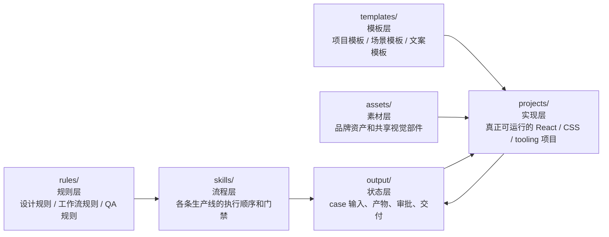
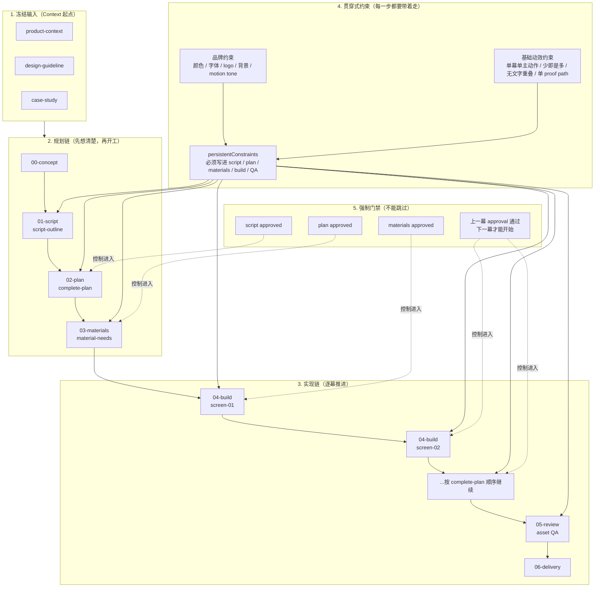

# lucius-video-as-code

[English](./README.md) | 简体中文

`lucius-video-as-code` 不是一个单纯堆项目的仓库，而是一套 **输入驱动的动画生产系统**。  
它把“做视频 / 做短素材”这件事拆成了：

- 冻结输入
- 明确生产线
- 合同化产物
- 审批门禁
- 浏览器实现
- QA 与交付

所以，这个仓库的核心不是“哪里能跑起来”，而是：

> **仓库如何组织 context、如何约束设计风格、以及如何强制每一步按规则往下走。**

## 仓库构成图



### 这张图怎么读

- `rules/`：定义边界，告诉你什么能做、什么不能做。
- `skills/`：定义流程，告诉你必须先做什么、后做什么、哪里要停下来等审批。
- `templates/`：定义模板，减少重复造轮子。
- `assets/`：定义共享品牌资产和通用视觉零件。
- `output/`：记录一个 case 当前走到哪一步、已经批准了什么、交付了什么。
- `projects/`：是真正运行在浏览器里的代码，或者用来做 pipeline 检查的工具项目。

简单说：

> `rules` 定边界，`skills` 定流程，`output` 定状态，`projects` 落代码。

## 仓库约束总图

下面这张图是现在仓库真正的约束结构。中间是主流程，左右是持续施加压力的规则和门禁。



### 这张图在说什么

这套系统不是“想到什么就直接写代码”，而是：

1. 先冻结输入  
2. 再写脚本大纲  
3. 再写完整方案  
4. 再写素材清单  
5. 审批通过后才开始 build  
6. build 还不是一口气做完，而是 **一幕一幕做**

同时，**品牌约束和基础动效约束必须贯穿全程**，不是最后 QA 才想起来看。

## 现在仓库里有哪几条生产线

目前有 **3 条生产线**。

### 1. Heavy lane

用于：

- `30-90s` 的 case study
- explainers
- 多幕叙事内容

特点：

- 以 `scene` 为主单位
- storyboard-first
- still preview 审批后再进 copy
- scene QA + final sequence QA

典型目录：

```text
output/<case-slug>/
  00-input/
  01-translation/
  02-constraints/
  03-storyboard/
  04-preview/
  05-copy/
  06-implementation/
  07-review/
  08-delivery/
```

### 2. Short lane

这是现在短素材的 **canonical 主生产线**。

用于：

- `6-10s` 短素材
- 一个清晰 takeaway
- 一个清晰 proof path
- 浏览器优先的短视频实现

特点：

- script-first
- `React + CSS`
- 一幕一幕 build
- 每一幕都要单独 approval

典型目录：

```text
output/<case-slug>/short-assets/<asset-slug>/
  00-concept/
  01-script/
  02-plan/
  03-materials/
  04-build/
  05-review/
  06-delivery/
```

### 3. Legacy short lane

这是旧的短素材流程。

特点：

- beatboard-first
- 现在主要保留给历史资产和实验
- 不是新工作的默认路线

## 设计风格是怎么被约束的

设计风格的最高来源不是某个项目组件，而是 Lucius 品牌规则：

- [rules/design/lucius-brand-application-rules.md](./rules/design/lucius-brand-application-rules.md)
- [rules/design/lucius-brand-tokens.json](./rules/design/lucius-brand-tokens.json)

### 当前仓库里写死的 Lucius 设计约束

- 品牌气质必须是：
  - `Intelligent`
  - `Collaborative`
  - `Quietly Confident`
- 颜色优先使用 Lucius palette：
  - `Lucius Purple`
  - `Warm Ivory`
  - `Lavender Mist`
  - `Orchid Bloom`
  - `Deep Moss`
- 字体分工固定：
  - `SF Pro` 负责 UI、标签、系统信息、说明文字
  - `Recoleta` 负责 headline、brand moment、收束句
- logo 必须用批准变体，并遵守 clear space
- 动效不能浮夸、不能霓虹、不能“AI 魔法感”

也就是说，**风格不是一种建议，而是一种仓库级约束。**

## Context 是怎么组织的

这个仓库不是边想边做，而是先把上游 context 冻结住。

每个 case 的输入固定是三份：

- `product-context`
- `design-guideline`
- `case-study`

路径固定在：

```text
output/<case-slug>/00-input/product-context.md
output/<case-slug>/00-input/design-guideline.md
output/<case-slug>/00-input/case-study.md
```

然后短素材默认走 script-first，把 context 往下转成这些阶段产物：

- `00-concept`
- `01-script`
- `02-plan`
- `03-materials`
- `04-build`
- `05-review`
- `06-delivery`

也就是说：

> 上游 context 先冻结，后面的每一步都只能基于已经批准过的 context 继续长出来。

## 强制规则是怎么执行的

真正强的地方，不是文档描述，而是 **gate + contract + approval**。

### 1. Gate 规则

关键 gate 文件：

- [rules/workflow/short-script-lane-gates.md](./rules/workflow/short-script-lane-gates.md)

生效方式：

- `script` 没批，不能进 `plan`
- `plan` 没批，不能进 `materials`
- `materials` 没批，不能进 `build`
- 当前幕没批，下一幕不能开始

### 2. Contract 规则

关键合同：

- [skills/shared/persistent-constraints-contract.md](./skills/shared/persistent-constraints-contract.md)
- [skills/shared/script-outline-contract.md](./skills/shared/script-outline-contract.md)
- [skills/shared/complete-plan-contract.md](./skills/shared/complete-plan-contract.md)

这些合同决定了每一阶段必须写哪些字段。

例如 `script-outline` 的 screen 必须有：

- `uiSurface`
- `layoutSnapshot`
- `background`
- `keyElements`
- `primaryMotion`
- `copyHint`
- `durationHint`

这就是为什么仓库现在会强制要求：

> 写大纲的时候就要把界面、背景、关键元素说清楚。

### 3. Persistent Constraints

`persistentConstraints` 是短素材最重要的贯穿式约束。

它必须在这些阶段都出现：

- `01-script`
- `02-plan`
- `03-materials`
- `04-build`
- `05-review`

其中必须包含：

- `brandConstraints`
- `baseMotionConstraints`

`baseMotionConstraints` 至少包括：

- `onePrimaryMotionPerScreen`
- `lessIsMore`
- `minimalCopy`
- `noTextOverlap`
- `singleProofPath`
- `quietlyConfidentMotion`

### 4. QA 规则

最终 QA 文件：

- [rules/quality/asset-qa-rules.md](./rules/quality/asset-qa-rules.md)

它会检查：

- hook 是否清楚
- 是否只服务一个 `singleTakeaway`
- 每幕是不是只有一个主动作
- 文案是否少且可读
- 是否无文字重叠
- 是否符合 Lucius 品牌约束
- 动效是否平滑，有没有 flicker / broken clipping / runtime 问题

## 顶层目录说明

| 路径 | 作用 |
| --- | --- |
| `assets/` | 共享品牌资产、logo、视觉零件 |
| `docs/` | 说明文档和补充资料 |
| `output/` | case 状态、审批、计划、QA、交付 |
| `projects/` | 真正运行的项目和工具 |
| `rules/` | 设计规则、workflow gate、QA 规则 |
| `skills/` | 生产线定义和 shared contracts |
| `templates/` | 项目模板、场景模板、文案模板 |
| `tmp/`, `_tmp_*`, `_review_frames/` | 临时目录，不属于 canonical 生产结构 |

## 当前项目目录

当前 `projects/` 下可见的项目包括：

- `projects/demo-app`
- `projects/pipeline-tools`
- `projects/case-study-dubbingai-discord`
- `projects/remotion-promo`
- `projects/gsap-animations`
- `projects/short-asset-ai-heavy-catch-you`
- `projects/short-assets-learn_from_conversations`
- `projects/short-assets-one_command_do_all`
- `projects/short-asset-thought-you-were-staff`

其中：

- `demo-app` 是主应用壳
- `pipeline-tools` 是 gate 和 contract tooling
- 其他则是不同阶段的 case study、promo 或 short asset 项目

## 根命令

安装依赖：

```bash
corepack pnpm install
```

运行主 demo：

```bash
corepack pnpm dev:demo
```

更新共享索引：

```bash
corepack pnpm pipeline:index-libraries
```

生成 heavy lane preview：

```bash
corepack pnpm pipeline:preview -- --case <case-slug>
```

检查 script-first short asset 阶段门禁：

```bash
corepack pnpm pipeline:assert:script-asset-stage -- --case <case-slug> --asset <asset-slug> --stage <script|plan|materials|build|review|delivery>
```

检查某一幕能不能开始：

```bash
corepack pnpm pipeline:assert:script-asset-stage -- --case <case-slug> --asset <asset-slug> --stage build --screen <screen-id>
```

## 新工作应该从哪里开始

如果你是新开一个生产任务，默认应该这样理解：

- 看 workflow：先看 `skills/`
- 看设计规则：看 `rules/design/`
- 看门禁：看 `rules/workflow/`
- 看 case 当前状态：看 `output/`
- 要真正落代码：进 `projects/`

不要上来就直接在 `projects/` 里写 UI，而不看：

- frozen inputs
- 当前 lane
- persistent constraints
- approval 状态

## 一句话总结

现在这个仓库的真实约束逻辑是：

> **先冻结输入，再按合同写 script / plan / materials，审批通过后逐幕实现，并让 Lucius 品牌规则和基础动效规则贯穿到最终 QA。**
