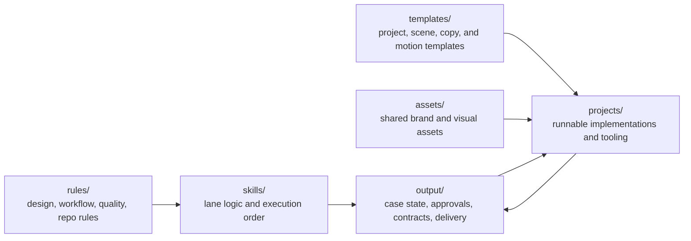
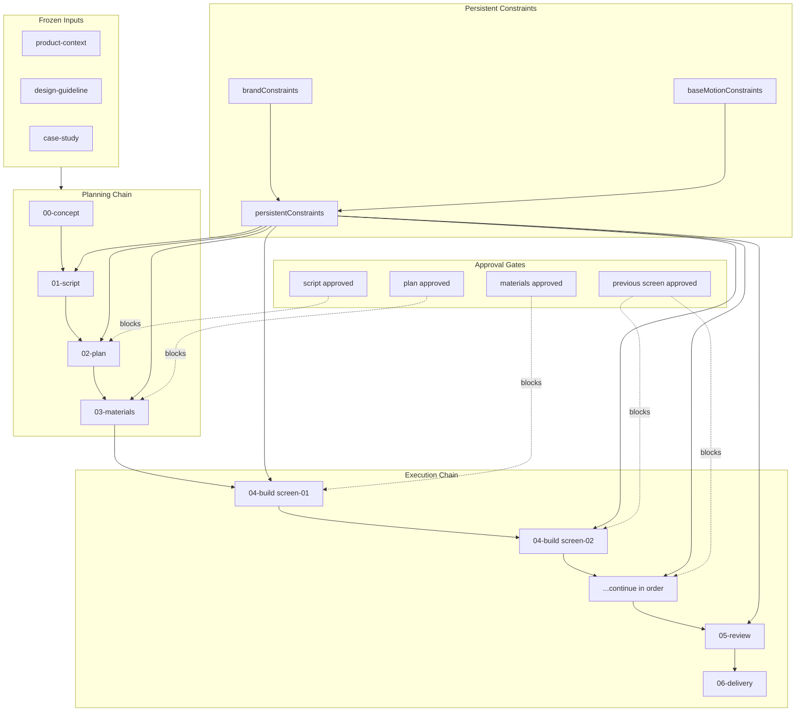

# lucius-video-as-code

English | [简体中文](./README-zh.md)

`lucius-video-as-code` is an input-driven animation production repository.
It is not just a collection of runnable demos. The repo is organized around:

- frozen context inputs
- explicit production lanes
- stage contracts
- approval gates
- browser-first implementation projects

The current system supports one long-form lane, one canonical short-form lane, and one legacy short-form lane.

## What This Repository Is

This repo treats motion work as a production pipeline:

`context -> planning -> constraints -> implementation -> approval -> QA -> delivery`

That means new work should usually start from `output/`, `skills/`, and `rules/`, then land in `projects/`.

## Repository Map



### How to read this

- `rules/` defines what is allowed and what is forbidden.
- `skills/` defines the lane workflow and gate order.
- `templates/` gives repeatable starting points instead of rebuilding everything from zero.
- `output/` is the source of truth for case state, planning artifacts, approvals, and delivery records.
- `projects/` contains the actual code that runs in the browser or powers tooling.

## Constraint System

The repo is constrained by three layers at the same time:

1. `rules/`
2. `skills/`
3. contracts plus approvals plus assertion tooling



### What this means in practice

- Design style is not applied at the end; it must persist from script through QA.
- Context is not freeform; it is frozen into input snapshots and then rewritten into structured stage artifacts.
- Build is not one-shot; the canonical short lane is screen-by-screen with approval after every screen.

## Top-Level Structure

| Path | Role |
| --- | --- |
| `assets/` | Shared brand assets, reusable visual parts, logos, and source materials |
| `docs/` | Supporting notes and reference docs |
| `output/` | Case-by-case state, approvals, plans, reviews, and delivery records |
| `projects/` | Runnable apps, experiments, and pipeline tooling |
| `rules/` | Design rules, workflow gates, repo rules, and QA rules |
| `skills/` | Lane definitions and shared contracts |
| `templates/` | Bootstrap templates and reusable planning/build scaffolds |
| `tmp/`, `_tmp_*`, `_review_frames/` | Scratch or temporary working areas; not canonical production structure |

## Production Lanes

The repository currently contains three production lanes.

### 1. Heavy lane

Use this for long-form work such as:

- `30-90s` case studies
- explainers
- multi-scene narrative sequences

Key properties:

- planning unit: `scene`
- storyboard-first
- still-preview approval before copy
- scene QA plus final sequence QA

Canonical output:

```text
output/<case-slug>/
  00-input/
  01-translation/
  02-constraints/
  03-storyboard/
  04-preview/
  05-copy/
  06-implementation/
  07-review/
  08-delivery/
```

### 2. Short lane

This is the canonical short-form lane for new short assets.

Use this for:

- `6-10s` assets
- one clear takeaway
- one clear proof path
- browser-first `React + CSS` implementation

Key properties:

- script-first
- one screen at a time
- one primary motion per screen
- browser review instead of Remotion-first delivery

Canonical output:

```text
output/<case-slug>/short-assets/<asset-slug>/
  00-concept/
  01-script/
  02-plan/
  03-materials/
  04-build/
  05-review/
  06-delivery/
```

### 3. Legacy short lane

This is the older beatboard-first short-asset flow. It is still readable for historical work and experiments, but it is no longer the default for new assets.

Typical legacy structure:

```text
output/<case-slug>/short-assets/<asset-slug>/
  01-translation/
  02-beatboard/
  03-animatic/
```

## Design Style Constraints

The highest design source of truth is:

- [`rules/design/lucius-brand-application-rules.md`](./rules/design/lucius-brand-application-rules.md)
- [`rules/design/lucius-brand-tokens.json`](./rules/design/lucius-brand-tokens.json)

### Core Lucius rules

- Brand personality must feel `Intelligent`, `Collaborative`, and `Quietly Confident`.
- Approved palette should lead the work:
  - `Lucius Purple`
  - `Warm Ivory`
  - `Lavender Mist`
  - `Orchid Bloom`
  - `Deep Moss`
- Typography roles are fixed:
  - `SF Pro` for UI, labels, system copy, and functional text
  - `Recoleta` for headlines, brand moments, and key closing lines
- Logo treatment is constrained by approved variants, contrast, and clear space.
- Motion must avoid neon, sci-fi magic, loud FX, and competing theatrical gestures.

## Context Organization

The repository freezes upstream context before planning begins.

Every case begins with three input snapshots:

- `product-context`
- `design-guideline`
- `case-study`

They live at:

```text
output/<case-slug>/00-input/product-context.md
output/<case-slug>/00-input/design-guideline.md
output/<case-slug>/00-input/case-study.md
```

Short assets then transform that frozen input into structured artifacts:

- `00-concept`
- `01-script`
- `02-plan`
- `03-materials`
- `04-build`
- `05-review`
- `06-delivery`

This means new work is expected to move from frozen context into formal contracts, not from vague prompts directly into code.

## Mandatory Short-Lane Rules

The canonical short lane is defined by:

- [`skills/short-script-lane/SKILL.md`](./skills/short-script-lane/SKILL.md)
- [`rules/workflow/short-script-lane-gates.md`](./rules/workflow/short-script-lane-gates.md)

### Hard rules

- No code before `script`, `plan`, and `materials` are explicitly approved.
- Screens must be built in the order defined by `02-plan/complete-plan.json`.
- No later screen may begin until the previous screen has its own build approval.
- Every screen must keep one primary motion.
- Minimal copy and no text overlap are mandatory.
- The short lane is browser-first and CSS-first.

## Shared Contracts

The short lane uses explicit contracts rather than loose planning notes.

Key shared contracts:

- [`skills/shared/persistent-constraints-contract.md`](./skills/shared/persistent-constraints-contract.md)
- [`skills/shared/script-outline-contract.md`](./skills/shared/script-outline-contract.md)
- [`skills/shared/complete-plan-contract.md`](./skills/shared/complete-plan-contract.md)

### Persistent constraints

Every script-first short asset must carry:

- `brandConstraints`
- `baseMotionConstraints`

`baseMotionConstraints` must preserve:

- `onePrimaryMotionPerScreen`
- `lessIsMore`
- `minimalCopy`
- `noTextOverlap`
- `singleProofPath`
- `quietlyConfidentMotion`

If a stage stops carrying those constraints forward, the stage is invalid.

## QA Rules

Final short-asset QA is governed by:

- [`rules/quality/asset-qa-rules.md`](./rules/quality/asset-qa-rules.md)

Short assets are expected to pass checks for:

- hook clarity
- single-takeaway discipline
- one-primary-motion-per-screen
- proof clarity
- readability and pacing
- Lucius brand fidelity
- technical smoothness in the browser

## Current Projects

| Path | Role |
| --- | --- |
| `projects/demo-app` | Main Lucius application shell and live demo environment |
| `projects/pipeline-tools` | Contract checks, library indexing, and stage tooling |
| `projects/case-study-dubbingai-discord` | Historical standalone case-study implementation |
| `projects/remotion-promo` | Remotion-based promo and motion work |
| `projects/gsap-animations` | Motion studies and animation experiments |
| `projects/short-asset-ai-heavy-catch-you` | Current script-first short asset with staged browser implementation |
| `projects/short-assets-learn_from_conversations` | Short-asset project from the remote branch |
| `projects/short-assets-one_command_do_all` | Short-asset project from the remote branch |
| `projects/short-asset-thought-you-were-staff` | Additional short-asset project currently present in the repo |

`projects/` remains the only pnpm workspace root.

## Root Commands

Install dependencies:

```bash
corepack pnpm install
```

Run the main demo app:

```bash
corepack pnpm dev:demo
```

Index shared libraries:

```bash
corepack pnpm pipeline:index-libraries
```

Generate heavy-lane storyboard preview payloads:

```bash
corepack pnpm pipeline:preview -- --case <case-slug>
```

Generate legacy short-lane animatic review data:

```bash
corepack pnpm pipeline:preview:animatic -- --case <case-slug> --asset <asset-slug>
```

Check script-first short-asset stage gates:

```bash
corepack pnpm pipeline:assert:script-asset-stage -- --case <case-slug> --asset <asset-slug> --stage <script|plan|materials|build|review|delivery>
```

Check whether a specific short-asset screen is allowed to begin:

```bash
corepack pnpm pipeline:assert:script-asset-stage -- --case <case-slug> --asset <asset-slug> --stage build --screen <screen-id>
```

## Where New Work Should Start

If you are starting new work:

- start from `output/` if the work is a production asset
- start from `skills/` and `rules/` if you need to understand the workflow
- start from `templates/` if you need a scaffold
- land in `projects/` only after the planning and approval path is clear

## In One Sentence

This repository is constrained so that frozen inputs become structured planning artifacts, structured artifacts pass explicit approval gates, and only then do runnable browser projects get built and reviewed under persistent Lucius brand and motion rules.
