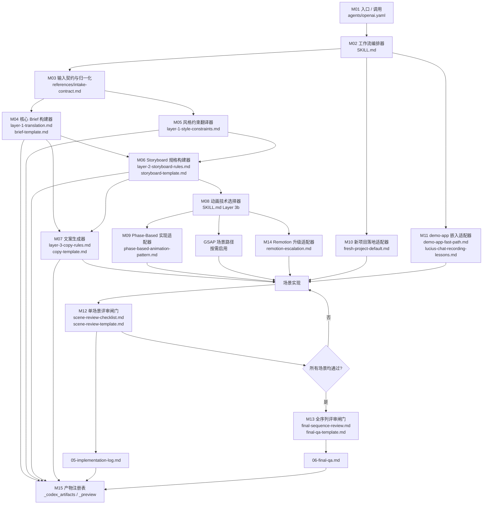
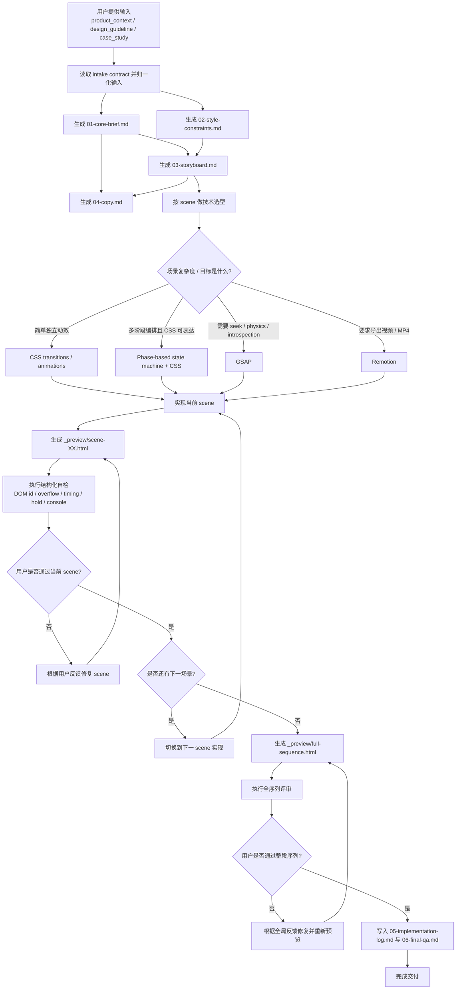
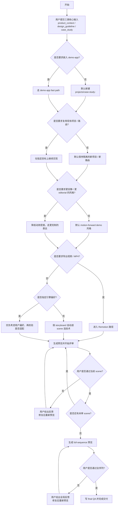

# case-study-code-animation 技能架构说明（中文版）

本文描述的是 `case-study-code-animation` 这个 skill 本身的架构，不是它生成出来的动画项目代码架构。

## 适用范围

- Skill 根目录：
  - `C:\Users\ASUS\.codex\skills\case-study-code-animation`
- 入口文件：
  - `agents/openai.yaml`
  - `SKILL.md`
- 支撑文件：
  - `assets/*.md`
  - `references/*.md`

## 一句话总结

这个 skill 本质上是一个“文档驱动 + 规则驱动 + 人工评审闸门驱动”的案例动画生产框架。

它不是靠一堆脚本自动跑完，而是靠：

- `SKILL.md` 负责编排流程
- `references/` 负责定义硬规则和决策依据
- `assets/` 负责定义标准输出模板
- `_preview/` 和 `_codex_artifacts/` 负责沉淀中间产物与评审结果

---

## Mermaid 1：架构图

---

## Mermaid 2：执行流程图

---

## Mermaid 3：用户决策图

---

## 模块清单

| 模块 ID | 模块名 | 核心文件 | 作用 |
|---|---|---|---|
| M01 | 入口 / 调用 | `agents/openai.yaml` | 向运行时暴露 skill |
| M02 | 工作流编排器 | `SKILL.md` | 定义流程顺序、停靠点、输出和 repo 默认行为 |
| M03 | 输入契约与归一化 | `references/intake-contract.md` | 统一输入格式，解决冲突优先级 |
| M04 | 核心 Brief 构建器 | `layer-1-translation.md` + `brief-template.md` | 提炼案例的业务意义与主叙事 |
| M05 | 风格约束翻译器 | `layer-1-style-constraints.md` | 将设计指导转成实现约束 |
| M06 | Storyboard 规格构建器 | `layer-2-storyboard-rules.md` + `storyboard-template.md` | 产出可直接实施的分镜规格 |
| M07 | 文案生成器 | `layer-3-copy-rules.md` + `copy-template.md` | 产出与画面行为对齐的屏幕文案 |
| M08 | 动画技术选择器 | `SKILL.md` Layer 3b | 按 scene 选择 CSS / Phase / GSAP / Remotion |
| M09 | Phase-Based 实现适配器 | `phase-based-animation-pattern.md` | 提供默认推荐的实现模式 |
| M10 | 新项目落地适配器 | `fresh-project-default.md` | 规定默认项目落地目录和结构 |
| M11 | demo-app 嵌入适配器 | `demo-app-fast-path.md` + `lucius-chat-recording-lessons.md` | 处理嵌入真实 app shell 的特例 |
| M12 | 单场景评审闸门 | `scene-review-checklist.md` + `scene-review-template.md` | 逐场景结构化校验和人工审批 |
| M13 | 全序列评审闸门 | `final-sequence-review.md` + `final-qa-template.md` | 完整序列的最终 QA |
| M14 | Remotion 升级适配器 | `remotion-escalation.md` | 在导出视频时切到 Remotion 路径 |
| M15 | 产物注册表 | `01-06` 产物规范 + `_preview/` | 统一持久化中间文档、预览和 QA 结果 |

---

## 模块功能对照文档

### M01. 入口 / 调用

- 核心文件：
  - `agents/openai.yaml`
- 模块功能：
  - 把 skill 注册给 Codex 运行时。
  - 定义展示名、默认提示词、是否允许隐式调用。
- 输入：
  - 用户自然语言请求。
  - 运行时的 skill 调度机制。
- 输出：
  - 激活 `case-study-code-animation` 这个 skill。
  - 将控制权交给 `SKILL.md`。
- 依赖：
  - 无业务依赖。
- 被谁使用：
  - M02 工作流编排器。

### M02. 工作流编排器

- 核心文件：
  - `SKILL.md`
- 模块功能：
  - 定义整个 skill 的主流程。
  - 规定阶段顺序、默认停靠点和输出文档。
  - 规定在 `lucius-video-as-code` 仓库中的默认落地方式。
  - 规定默认风格偏向 motion-forward demo。
- 输入：
  - 来自 M01 的 skill 激活。
  - 用户输入材料。
  - `references/` 规则文件。
  - `assets/` 模板文件。
- 输出：
  - 规范化执行顺序。
  - 必须产出的文档集合：
    - `01-core-brief.md`
    - `02-style-constraints.md`
    - `03-storyboard.md`
    - `04-copy.md`
    - `05-implementation-log.md`
    - `06-final-qa.md`
- 依赖：
  - M03-M15。
- 被谁使用：
  - 整个 skill 的所有阶段都受它约束。

### M03. 输入契约与归一化

- 核心文件：
  - `references/intake-contract.md`
- 模块功能：
  - 定义 skill 的必需输入和可选输入。
  - 把零散输入统一成一套标准工作集。
  - 定义信息冲突时的优先级。
- 输入：
  - 必需输入：
    - `product_context`
    - `design_guideline`
    - `case_study`
  - 可选输入：
    - target route or scene name
    - desired duration
    - preferred engine
    - preferred outcome scene
    - request to reuse an existing route
- 输出：
  - 统一后的工作集：
    - product summary
    - target audience
    - case study facts
    - evidence or proof points
    - desired visual direction
    - explicit constraints
    - open questions
- 依赖：
  - 用户提供的原始材料。
- 被谁使用：
  - M04、M05、M10、M11。

### M04. 核心 Brief 构建器

- 核心文件：
  - `references/layer-1-translation.md`
  - `assets/brief-template.md`
- 模块功能：
  - 提炼产品上下文和案例事实。
  - 形成一个紧凑的战略 brief。
  - 区分“证据”和“解释”。
- 输入：
  - M03 归一化后的工作集。
  - brief 模板。
- 输出：
  - `01-core-brief.md`
  - 核心栏目：
    - Inputs
    - Audience
    - Why
    - How
    - What
    - Highlight
    - Proof Points
    - Must-Keep Claims
    - Open Risks Or Uncertainties
- 依赖：
  - M03。
- 被谁使用：
  - M06、M07、M15。

### M05. 风格约束翻译器

- 核心文件：
  - `references/layer-1-style-constraints.md`
- 模块功能：
  - 把设计指导从“感觉”翻译成“规则”。
  - 形成代码实现可直接使用的硬约束。
- 输入：
  - M03 中的 `design_guideline`。
- 输出：
  - `02-style-constraints.md`
  - 主要约束维度：
    - 配色与对比度
    - 字体与层级
    - 间距与容器
    - 构图规则
    - 动效规则
    - 禁止项
    - 组件表面规则
    - 资产处理规则
- 依赖：
  - M03。
- 被谁使用：
  - M06、M08、M12、M13。

### M06. Storyboard 规格构建器

- 核心文件：
  - `references/layer-2-storyboard-rules.md`
  - `assets/storyboard-template.md`
- 模块功能：
  - 把 narrative 和 style constraints 变成开发可实施的分镜规格书。
  - 明确场景布局、元素、时间轴、停留段和退场方式。
  - 作为后续实现的合同。
- 输入：
  - `01-core-brief.md`
  - `02-style-constraints.md`
  - storyboard 模板
- 输出：
  - `03-storyboard.md`
  - 每个 scene 至少包含：
    - scene id 和 purpose
    - narrative
    - layout mode 与 CSS shorthand
    - container constraints
    - elements table
    - initial state table
    - timeline table
    - hold
    - exit / transition
- 依赖：
  - M04、M05。
- 被谁使用：
  - M07、M08、M09、M12、M13。

### M07. 文案生成器

- 核心文件：
  - `references/layer-3-copy-rules.md`
  - `assets/copy-template.md`
- 模块功能：
  - 生成与屏幕行为一致的文案。
  - 保证文案不是脱离画面的抽象营销语。
- 输入：
  - `01-core-brief.md`
  - `03-storyboard.md`
  - 产品原始用词
- 输出：
  - `04-copy.md`
  - 常见部分：
    - intertitles
    - scene headline
    - support copy
    - labels
    - answer / outcome copy
- 依赖：
  - M03、M04、M06。
- 被谁使用：
  - 场景实现
  - M12、M13。

### M08. 动画技术选择器

- 核心文件：
  - `SKILL.md` Layer 3b
- 模块功能：
  - 为每个 scene 单独选实现技术。
  - 防止整个项目被一种技术绑死。
  - 优先使用足够轻但结构清晰的方案。
- 输入：
  - `03-storyboard.md` 中各场景的复杂度。
  - 用户可选的引擎偏好。
- 输出：
  - 每个 scene 的技术决策，记录进 `05-implementation-log.md`。
  - 可能的选择：
    - CSS
    - Phase-based state machine + CSS
    - GSAP
    - Remotion
- 依赖：
  - M06。
- 被谁使用：
  - M09、M12、M14、场景实现阶段。

### M09. Phase-Based 实现适配器

- 核心文件：
  - `references/phase-based-animation-pattern.md`
- 模块功能：
  - 提供首选实现架构。
  - 把编排控制和视觉表现拆开。
  - 用 phase 驱动场景状态，用 CSS 响应 phase。
- 输入：
  - M06 的时间轴规格。
  - M08 的技术选择结果。
- 输出：
  - 典型实现结构：
    - JS/TS phase controller
    - `data-phase`
    - `data-el`
    - CSS phase selector
    - CSS timing variables
- 依赖：
  - M06、M08。
- 被谁使用：
  - 场景实现
  - M12。

### M10. 新项目落地适配器

- 核心文件：
  - `references/fresh-project-default.md`
- 模块功能：
  - 规定默认落地目录。
  - 让每次 case study 生成都在隔离的新项目中进行。
- 输入：
  - 当前 repo 上下文。
  - 用户是否要求复用已有项目。
- 输出：
  - 默认项目目录：
    - `projects/case-study-<slug>/`
  - 默认项目结构：
    - `src/scenes/`
    - `src/components/`
    - `src/data/`
    - `src/styles/`
    - `src/main.tsx`
    - `package.json`
    - `_codex_artifacts/`
- 依赖：
  - repo 结构。
- 被谁使用：
  - 实现阶段
  - M15。

### M11. demo-app 嵌入适配器

- 核心文件：
  - `references/demo-app-fast-path.md`
  - `references/lucius-chat-recording-lessons.md`
- 模块功能：
  - 处理“要嵌入真实 Lucius app shell”的特殊路径。
  - 复用 demo-app 的既有能力，但不默认污染主流程。
- 输入：
  - 用户显式要求嵌入 demo-app。
  - `projects/demo-app` 现有上下文。
- 输出：
  - demo-app 内的新 route 或新 scene。
  - 工件落地路径：
    - `projects/demo-app/_codex_case_studies/<slug>/`
  - 默认验证方式：
    - `pnpm build:demo`
    - `pnpm preview:demo`
- 依赖：
  - M03
  - demo-app 现有代码。
- 被谁使用：
  - 实现阶段
  - M12、M13。

### M12. 单场景评审闸门

- 核心文件：
  - `references/scene-review-checklist.md`
  - `assets/scene-review-template.md`
- 模块功能：
  - 对每个 scene 做“结构化自检 + 人工评审”双重闸门。
  - 未通过不得进入下一场景。
- 输入：
  - 当前 scene 实现结果。
  - `_preview/scene-XX.html`
  - `03-storyboard.md`
  - 用户反馈。
- 输出：
  - scene 通过 / 不通过。
  - 评审记录写入 `05-implementation-log.md`。
  - 用户反馈原文。
- 必检项：
  - 所有 storyboard element id 是否存在于 DOM `data-el`
  - 是否存在非法 absolute positioning
  - 是否 overflow
  - timing / easing 是否符合规格
  - 是否存在 hold phase
  - 预览是否正常加载
  - 是否可以循环播放
- 依赖：
  - M06、M08、具体 scene 实现。
- 被谁使用：
  - M13
  - M15。

### M13. 全序列评审闸门

- 核心文件：
  - `references/final-sequence-review.md`
  - `assets/final-qa-template.md`
- 模块功能：
  - 在全部 scene 单独通过后，执行整段序列的最终 QA。
  - 检查节奏、衔接、叙事推进、动效一致性。
- 输入：
  - 全部已通过的 scene。
  - `_preview/full-sequence.html`
  - storyboard 中的场景顺序与转场设定。
- 输出：
  - `06-final-qa.md`
  - 最终结论：
    - approved
    - approved with notes
    - needs rework
- 依赖：
  - M06
  - 全部 scene 的通过状态。
- 被谁使用：
  - M15
  - 最终交付阶段。

### M14. Remotion 升级适配器

- 核心文件：
  - `references/remotion-escalation.md`
- 模块功能：
  - 在用户明确要求可导出视频时，把实现路径切到 Remotion。
  - 保持前面的 brief / constraints / storyboard / copy 流程不变。
- 输入：
  - 用户的导出视频诉求：
    - MP4
    - composition-based delivery
    - timeline-locked render
    - render automation
  - M08 的技术决策。
- 输出：
  - Remotion 路径下的实现方案。
- 依赖：
  - M08。
- 被谁使用：
  - 视频导出场景的实现阶段。

### M15. 产物注册表

- 核心文件：
  - `SKILL.md` 中规定的所有产物
  - `_codex_artifacts/`
  - `_preview/`
- 模块功能：
  - 统一定义哪些文件必须被持久化。
  - 让每个阶段的结果都可复查、可迭代、可对比。
- 输入：
  - M04-M14 的阶段输出。
- 输出：
  - `_codex_artifacts/01-core-brief.md`
  - `_codex_artifacts/02-style-constraints.md`
  - `_codex_artifacts/03-storyboard.md`
  - `_codex_artifacts/04-copy.md`
  - `_codex_artifacts/05-implementation-log.md`
  - `_codex_artifacts/06-final-qa.md`
  - `_preview/scene-XX.html`
  - `_preview/full-sequence.html`
- 依赖：
  - 全流程阶段结果。
- 被谁使用：
  - 用户
  - 后续实现迭代
  - 最终审阅与归档。

---

## 模块依赖关系表

| 模块 | 依赖谁 | 为谁提供输出 |
|---|---|---|
| M01 | 运行时调度 | M02 |
| M02 | M01 | 全部模块 |
| M03 | M02 | M04、M05、M10、M11 |
| M04 | M03 | M06、M07、M15 |
| M05 | M03 | M06、M08、M12、M13 |
| M06 | M04、M05 | M07、M08、M09、M12、M13 |
| M07 | M03、M04、M06 | 实现阶段、评审阶段 |
| M08 | M06 | M09、M12、M14、实现阶段 |
| M09 | M06、M08 | 实现阶段、M12 |
| M10 | repo 上下文 | 实现阶段、M15 |
| M11 | 用户显式要求 + demo-app 上下文 | 实现阶段、M12、M13 |
| M12 | 实现场景 + storyboard + 用户反馈 | M13、M15 |
| M13 | 全部通过的 scene + full-sequence preview | M15 |
| M14 | 导出视频诉求 + M08 | 视频导出实现 |
| M15 | 全阶段输出 | 归档、复查、交付 |

---

## 结论

这个 skill 的真正核心不是某个动画库，而是这条分层生产链：

`输入归一化 -> brief -> 风格约束 -> storyboard 规格 -> 文案 -> 按 scene 技术选型 -> 单场景评审 -> 全序列评审 -> 产物归档`

所以如果你要继续改造这个 skill，优先级通常应该是：

1. 改 `SKILL.md` 的流程和 gate。
2. 改 `references/` 的规则。
3. 改 `assets/` 的模板。
4. 最后才是改生成项目的实现细节。
