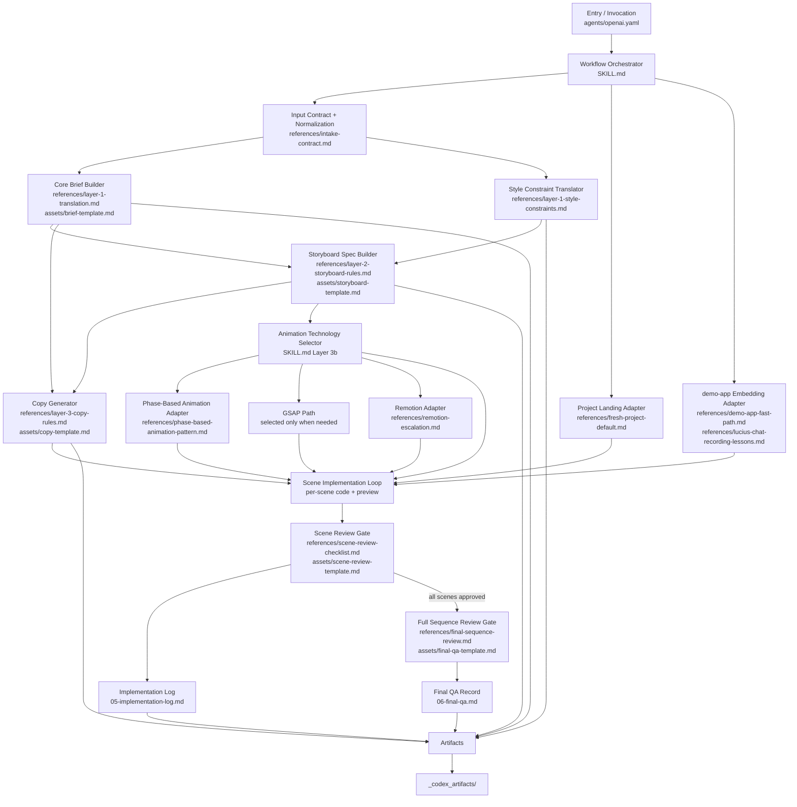

# Case Study Code Animation Skill Architecture

This document describes the architecture of the `case-study-code-animation` skill itself, not the generated animation project.

## Scope

- Skill root: `C:\Users\ASUS\.codex\skills\case-study-code-animation`
- Entry files:
  - `agents/openai.yaml`
  - `SKILL.md`
- Support files:
  - `assets/*.md`
  - `references/*.md`

## Module Relationship Diagram

## Control Model

The skill is a document-driven workflow orchestrator with explicit review gates:

1. Invocation enters through the skill manifest.
2. `SKILL.md` decides the stage order and stop points.
3. `references/` define hard rules and decision criteria.
4. `assets/` define the expected output format.
5. The generated project and artifacts become the runtime output of the skill.

This means the skill does not primarily execute work through local scripts. It executes by constraining Codex behavior through:

- staged instructions
- templates
- rule files
- explicit human approval gates

## Module Inventory

| ID | Module | Core Files | Role |
|---|---|---|---|
| M01 | Entry / Invocation | `agents/openai.yaml` | Exposes the skill to the agent runtime |
| M02 | Workflow Orchestrator | `SKILL.md` | Defines stage order, gates, output expectations, and repo defaults |
| M03 | Input Contract + Normalization | `references/intake-contract.md` | Normalizes source material into a canonical working set |
| M04 | Core Brief Builder | `references/layer-1-translation.md`, `assets/brief-template.md` | Converts case-study inputs into a compact strategy brief |
| M05 | Style Constraint Translator | `references/layer-1-style-constraints.md` | Converts design guidance into implementation constraints |
| M06 | Storyboard Spec Builder | `references/layer-2-storyboard-rules.md`, `assets/storyboard-template.md` | Produces implementation-grade scene specs |
| M07 | Copy Generator | `references/layer-3-copy-rules.md`, `assets/copy-template.md` | Produces low-friction on-screen copy aligned to scenes |
| M08 | Animation Technology Selector | `SKILL.md` Layer 3b | Chooses CSS, phase-based CSS, GSAP, or Remotion per scene |
| M09 | Phase-Based Animation Adapter | `references/phase-based-animation-pattern.md` | Defines the preferred implementation architecture for most scenes |
| M10 | Project Landing Adapter | `references/fresh-project-default.md` | Decides where generated work lands by default |
| M11 | demo-app Embedding Adapter | `references/demo-app-fast-path.md`, `references/lucius-chat-recording-lessons.md` | Handles the non-default in-app embedding route |
| M12 | Scene Review Gate | `references/scene-review-checklist.md`, `assets/scene-review-template.md` | Enforces per-scene structural QA and human approval |
| M13 | Full Sequence Review Gate | `references/final-sequence-review.md`, `assets/final-qa-template.md` | Enforces end-to-end sequence QA |
| M14 | Remotion Adapter | `references/remotion-escalation.md` | Switches rendering path only when export-ready video is requested |
| M15 | Artifact Registry | `01-06` artifact outputs in `SKILL.md` | Standardizes persistent outputs and review records |

## Detailed Module Specification

### M01. Entry / Invocation

- Files:
  - `agents/openai.yaml`
- Function:
  - Registers the skill in the Codex runtime.
  - Defines the display name and default prompt.
  - Allows implicit invocation.
- Inputs:
  - User request text.
  - Runtime skill-dispatch mechanism.
- Outputs:
  - Activation of the skill workflow.
  - Transfer of control to `SKILL.md`.
- Downstream consumers:
  - M02 Workflow Orchestrator.
- Notes:
  - This module does not implement the workflow. It only exposes it.

### M02. Workflow Orchestrator

- Files:
  - `SKILL.md`
- Function:
  - Acts as the main controller for the entire skill.
  - Defines the ordered pipeline from input normalization to final QA.
  - Defines default stop points after each artifact stage.
  - Defines repo-specific behavior for `lucius-video-as-code`.
  - Defines the default bias toward motion-forward demos.
- Inputs:
  - Skill activation from M01.
  - Normalized user materials.
  - Rule files and templates from `references/` and `assets/`.
- Outputs:
  - Ordered execution plan.
  - Artifact requirements:
    - `01-core-brief.md`
    - `02-style-constraints.md`
    - `03-storyboard.md`
    - `04-copy.md`
    - `05-implementation-log.md`
    - `06-final-qa.md`
  - Project location guidance.
  - Review gate requirements.
- Downstream consumers:
  - All other modules.
- Notes:
  - This is the real control plane of the skill.
  - If `agents/openai.yaml` is the entrypoint, `SKILL.md` is the orchestrator.

### M03. Input Contract + Normalization

- Files:
  - `references/intake-contract.md`
- Function:
  - Defines what input categories the skill expects.
  - Normalizes heterogeneous sources into a canonical working set.
  - Defines conflict-resolution priority across sources.
- Inputs:
  - Required:
    - `product_context`
    - `design_guideline`
    - `case_study`
  - Optional:
    - target route or scene name
    - desired duration
    - preferred engine
    - preferred outcome scene
    - request to reuse an existing route
- Outputs:
  - Canonical normalized sections:
    - product summary
    - target audience
    - case study facts
    - evidence or proof points
    - desired visual direction
    - explicit constraints
    - open questions
- Downstream consumers:
  - M04 Core Brief Builder
  - M05 Style Constraint Translator
  - M10/M11 project path decision
- Notes:
  - This module protects the rest of the workflow from ambiguous source material.
  - It also prevents silent invention by requiring unresolved conflicts to be recorded.

### M04. Core Brief Builder

- Files:
  - `references/layer-1-translation.md`
  - `assets/brief-template.md`
- Function:
  - Translates product context and case-study facts into a compact strategic brief.
  - Separates evidence from interpretation.
  - Extracts the viewer-facing business meaning of the project.
- Inputs:
  - Normalized working set from M03.
  - Brief output structure from `assets/brief-template.md`.
- Outputs:
  - `01-core-brief.md`
  - Required sections:
    - Inputs
    - Audience
    - Why
    - How
    - What
    - Highlight
    - Proof Points
    - Must-Keep Claims
    - Open Risks Or Uncertainties
- Downstream consumers:
  - M06 Storyboard Spec Builder
  - M07 Copy Generator
  - M15 Artifact Registry
- Notes:
  - This module defines the narrative intent before visuals are specified.

### M05. Style Constraint Translator

- Files:
  - `references/layer-1-style-constraints.md`
- Function:
  - Converts design guidance into code-facing constraints.
  - Changes abstract aesthetic preferences into enforceable implementation rules.
- Inputs:
  - `design_guideline` portion of normalized input from M03.
- Outputs:
  - `02-style-constraints.md`
  - Constraint categories:
    - palette and contrast
    - typography
    - spacing and container logic
    - composition rules
    - motion rules
    - forbidden effects
    - component surface rules
    - asset treatment rules
  - Each rule is expected to include:
    - rule
    - rationale
    - implementation note
    - forbidden deviation when relevant
- Downstream consumers:
  - M06 Storyboard Spec Builder
  - M08 Animation Technology Selector
  - M12 Scene Review Gate
  - M13 Full Sequence Review Gate
- Notes:
  - This module turns visual direction into a constraint system, not a mood board.

### M06. Storyboard Spec Builder

- Files:
  - `references/layer-2-storyboard-rules.md`
  - `assets/storyboard-template.md`
- Function:
  - Produces a scene-by-scene implementation spec.
  - Converts narrative and constraints into layout, motion, timing, and transition definitions.
  - Establishes the spec that implementation is expected to follow.
- Inputs:
  - `01-core-brief.md` from M04.
  - `02-style-constraints.md` from M05.
  - Storyboard schema from `assets/storyboard-template.md`.
- Outputs:
  - `03-storyboard.md`
  - Per scene:
    - scene id and purpose
    - narrative
    - layout mode and CSS shorthand
    - container constraints
    - element table
    - initial state table
    - timeline table with numeric timing
    - hold phase
    - exit and transition spec
- Downstream consumers:
  - M07 Copy Generator
  - M08 Animation Technology Selector
  - M09 Phase-Based Animation Adapter
  - M12 Scene Review Gate
  - M13 Full Sequence Review Gate
- Hard constraints:
  - No prose-only motion description.
  - No unspecified stagger.
  - No content layout based on `position: absolute`.
  - No scene without a hold phase.
- Notes:
  - This is the most implementation-critical module in the skill.
  - It is the contract between planning and coding.

### M07. Copy Generator

- Files:
  - `references/layer-3-copy-rules.md`
  - `assets/copy-template.md`
- Function:
  - Produces concise on-screen copy aligned to what the viewer will see.
  - Ensures text supports the motion and scene purpose rather than drifting into generic marketing.
- Inputs:
  - `01-core-brief.md` from M04.
  - `03-storyboard.md` from M06.
  - Product wording from normalized input in M03.
- Outputs:
  - `04-copy.md`
  - Sections typically include:
    - intertitles
    - per-scene headline
    - support copy
    - labels
    - answer or outcome copy
- Downstream consumers:
  - Scene implementation
  - M12 Scene Review Gate
  - M13 Full Sequence Review Gate
- Notes:
  - This module is constrained by scene behavior, not the other way around.

### M08. Animation Technology Selector

- Files:
  - `SKILL.md` Layer 3b
- Function:
  - Selects the implementation technology per scene.
  - Prevents over-committing the whole project to one animation stack.
  - Biases the system toward lightweight but structured implementation.
- Inputs:
  - `03-storyboard.md` from M06.
  - Scene complexity and timing requirements.
  - Optional engine preference from M03.
- Outputs:
  - Per-scene technology decision recorded in `05-implementation-log.md`.
  - Decision branches:
    - CSS transitions/animations
    - phase-based state machine + CSS
    - GSAP timeline
    - Remotion
- Downstream consumers:
  - M09 Phase-Based Animation Adapter
  - Scene implementation
  - M14 Remotion Adapter
- Decision rules:
  - Simple independent animations: CSS.
  - Sequenced multi-phase but CSS-expressible scenes: phase-based state machine + CSS.
  - Seekable or physics-heavy scenes: GSAP.
  - Export-ready rendering: Remotion.
- Notes:
  - This module is a policy engine, not a renderer.

### M09. Phase-Based Animation Adapter

- Files:
  - `references/phase-based-animation-pattern.md`
- Function:
  - Defines the preferred implementation architecture for most scenes.
  - Separates choreography control from visual styling.
  - Maps storyboard timing into named state phases.
- Inputs:
  - Scene timing spec from `03-storyboard.md`.
  - Per-scene technology choice from M08.
- Outputs:
  - Implementation pattern:
    - JS/TS phase controller
    - scene container `data-phase`
    - element-level `data-el`
    - CSS selectors keyed by phase
    - CSS custom properties for timing
  - Preview acceleration pattern through timing scale.
- Downstream consumers:
  - Scene implementation
  - M12 Scene Review Gate
- Notes:
  - This is the preferred architectural template because it keeps choreography inspectable without a heavy timeline library.

### M10. Project Landing Adapter

- Files:
  - `references/fresh-project-default.md`
- Function:
  - Defines where the generated output should land by default in `lucius-video-as-code`.
  - Keeps each case-study run isolated.
- Inputs:
  - Repo context.
  - Optional user request to reuse an existing project.
- Outputs:
  - New default destination:
    - `projects/case-study-<slug>/`
  - Suggested project shape:
    - `src/scenes/`
    - `src/components/`
    - `src/data/`
    - `src/styles/`
    - `src/main.tsx`
    - `package.json`
    - `_codex_artifacts/`
- Downstream consumers:
  - Scene implementation
  - M15 Artifact Registry
- Notes:
  - This module is about isolation and safe iteration.

### M11. demo-app Embedding Adapter

- Files:
  - `references/demo-app-fast-path.md`
  - `references/lucius-chat-recording-lessons.md`
- Function:
  - Handles the special case where the user wants the animation embedded into the real Lucius app shell.
  - Reuses proven route-based demo behavior when appropriate.
- Inputs:
  - Explicit user request for in-app embedding.
  - Existing `projects/demo-app` context.
- Outputs:
  - New isolated route or scene inside `projects/demo-app`.
  - Artifacts stored under:
    - `projects/demo-app/_codex_case_studies/<slug>/`
  - Validation path:
    - `pnpm build:demo`
    - `pnpm preview:demo`
- Downstream consumers:
  - Scene implementation
  - M12 Scene Review Gate
  - M13 Full Sequence Review Gate
- Notes:
  - This is explicitly non-default.
  - It introduces extra layout and shell constraints, so it is intentionally gated.

### M12. Scene Review Gate

- Files:
  - `references/scene-review-checklist.md`
  - `assets/scene-review-template.md`
- Function:
  - Enforces a two-part QA loop for every scene:
    - structural checks by the agent
    - aesthetic and clarity review by the user
  - Prevents the workflow from advancing scene-by-scene without approval.
- Inputs:
  - Implemented scene.
  - `03-storyboard.md`
  - Preview file `_preview/scene-XX.html`
  - Scene technology choice from M08.
- Outputs:
  - Scene review record inside `05-implementation-log.md`.
  - Approval or rejection for the scene.
  - User feedback captured verbatim.
- Structural checks:
  - all storyboard ids exist in DOM as `data-el`
  - no invalid absolute positioning
  - no overflow
  - timing/easing compliance
  - hold phase exists
  - preview loads without errors
  - preview loops correctly
- Downstream consumers:
  - M13 Full Sequence Review Gate
  - M15 Artifact Registry
- Notes:
  - This module is the primary human-in-the-loop guardrail.

### M13. Full Sequence Review Gate

- Files:
  - `references/final-sequence-review.md`
  - `assets/final-qa-template.md`
- Function:
  - Runs the end-to-end QA pass after all scenes have individually passed.
  - Validates pacing, continuity, motion consistency, and narrative closure.
- Inputs:
  - All approved scenes.
  - `_preview/full-sequence.html`
  - Storyboard order and transition spec from M06.
- Outputs:
  - `06-final-qa.md`
  - Final verdict:
    - approved
    - approved with notes
    - needs rework
  - Known accepted issues if any.
- Downstream consumers:
  - Final delivery decision.
  - M15 Artifact Registry.
- Notes:
  - This module validates the sequence as a film-like whole, not just scene correctness.

### M14. Remotion Adapter

- Files:
  - `references/remotion-escalation.md`
- Function:
  - Switches the workflow from preview-first code animation to export-capable rendering when required.
  - Preserves the same planning stack while changing the rendering engine.
- Inputs:
  - Explicit user request for:
    - MP4 export
    - composition-based output
    - timeline-locked rendering
    - render automation
  - Technology decision from M08.
- Outputs:
  - Remotion-based implementation path.
  - Same planning artifacts as the normal path.
- Downstream consumers:
  - Scene implementation when video rendering is required.
- Notes:
  - This module is intentionally gated to avoid over-escalation into heavier tooling.

### M15. Artifact Registry

- Files:
  - Artifact list in `SKILL.md`
  - Output folders under generated project
- Function:
  - Defines the persistent outputs that make the workflow reviewable and reusable.
  - Standardizes what must be written to disk after each stage.
- Inputs:
  - Outputs from M04 to M13.
- Outputs:
  - `_codex_artifacts/01-core-brief.md`
  - `_codex_artifacts/02-style-constraints.md`
  - `_codex_artifacts/03-storyboard.md`
  - `_codex_artifacts/04-copy.md`
  - `_codex_artifacts/05-implementation-log.md`
  - `_codex_artifacts/06-final-qa.md`
  - `_preview/scene-XX.html`
  - `_preview/full-sequence.html`
- Downstream consumers:
  - Human reviewers
  - Later implementation passes
  - Future comparison / audit
- Notes:
  - This module is what makes the skill stateful across stages even though it is instruction-driven.

## Module Dependency Matrix

| Module | Depends On | Produces For |
|---|---|---|
| M01 Entry | runtime dispatch | M02 |
| M02 Orchestrator | M01 | all modules |
| M03 Input Normalization | M02 | M04, M05, M10, M11 |
| M04 Core Brief | M03 | M06, M07, M15 |
| M05 Style Constraints | M03 | M06, M08, M12, M13 |
| M06 Storyboard | M04, M05 | M07, M08, M09, M12, M13 |
| M07 Copy | M03, M04, M06 | implementation, review |
| M08 Tech Selection | M06 | implementation adapters |
| M09 Phase Adapter | M06, M08 | implementation, M12 |
| M10 Fresh Project Landing | repo context, M02 | implementation, M15 |
| M11 demo-app Adapter | explicit user request, repo context | implementation, review |
| M12 Scene Review | implementation, M06, M08 | M13, M15 |
| M13 Final Review | approved scenes, M06 | M15 |
| M14 Remotion Adapter | M08, explicit export request | implementation |
| M15 Artifact Registry | M04-M14 outputs | persistent review state |

## Data Contracts by Stage

### Stage A: Intake Contract

- Input object:
  - `product_context`
  - `design_guideline`
  - `case_study`
  - optional preferences
- Output object:
  - normalized working set

### Stage B: Strategy Contract

- Input object:
  - normalized working set
- Output objects:
  - `01-core-brief.md`
  - `02-style-constraints.md`

### Stage C: Implementation Spec Contract

- Input objects:
  - core brief
  - style constraints
- Output object:
  - `03-storyboard.md`

### Stage D: Screen Copy Contract

- Input objects:
  - core brief
  - storyboard
- Output object:
  - `04-copy.md`

### Stage E: Technology Contract

- Input object:
  - storyboard timeline complexity per scene
- Output object:
  - per-scene engine decision in `05-implementation-log.md`

### Stage F: Human Review Contract

- Input objects:
  - scene preview or full-sequence preview
  - storyboard-derived questions
  - user feedback
- Output objects:
  - updated implementation log
  - final QA log

## Architectural Characteristics

### 1. Instruction-First, Not Script-First

The skill is mostly architecture-by-instructions. The behavior lives in:

- `SKILL.md`
- `references/*.md`
- `assets/*.md`

not in executable utility scripts.

### 2. Spec-Driven Implementation

The storyboard is treated as a formal implementation contract. That is the main architectural choice of the skill.

### 3. Review-Gated Progression

The skill is explicitly stateful through human approval gates and persisted artifacts.

### 4. Per-Scene Technology Polymorphism

The skill can mix animation engines scene-by-scene instead of forcing one engine across the whole project.

### 5. Repo-Aware Landing Logic

The skill contains path adapters for:

- fresh isolated projects
- in-app demo embedding
- Remotion escalation

## Short Summary

The `case-study-code-animation` skill is best understood as a layered production framework:

- `agents/openai.yaml` exposes it
- `SKILL.md` orchestrates it
- `references/` define constraints and decisions
- `assets/` define output shapes
- generated project folders and `_codex_artifacts/` persist the workflow state

Its core architectural idea is:

`intake -> brief -> constraints -> storyboard spec -> copy -> per-scene tech selection -> scene review gates -> final sequence review`
